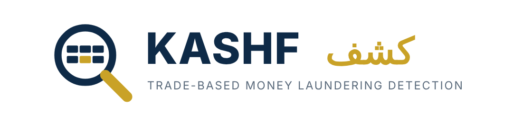
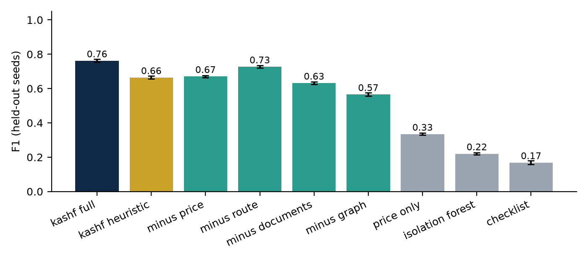
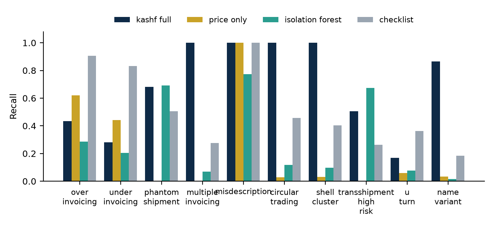
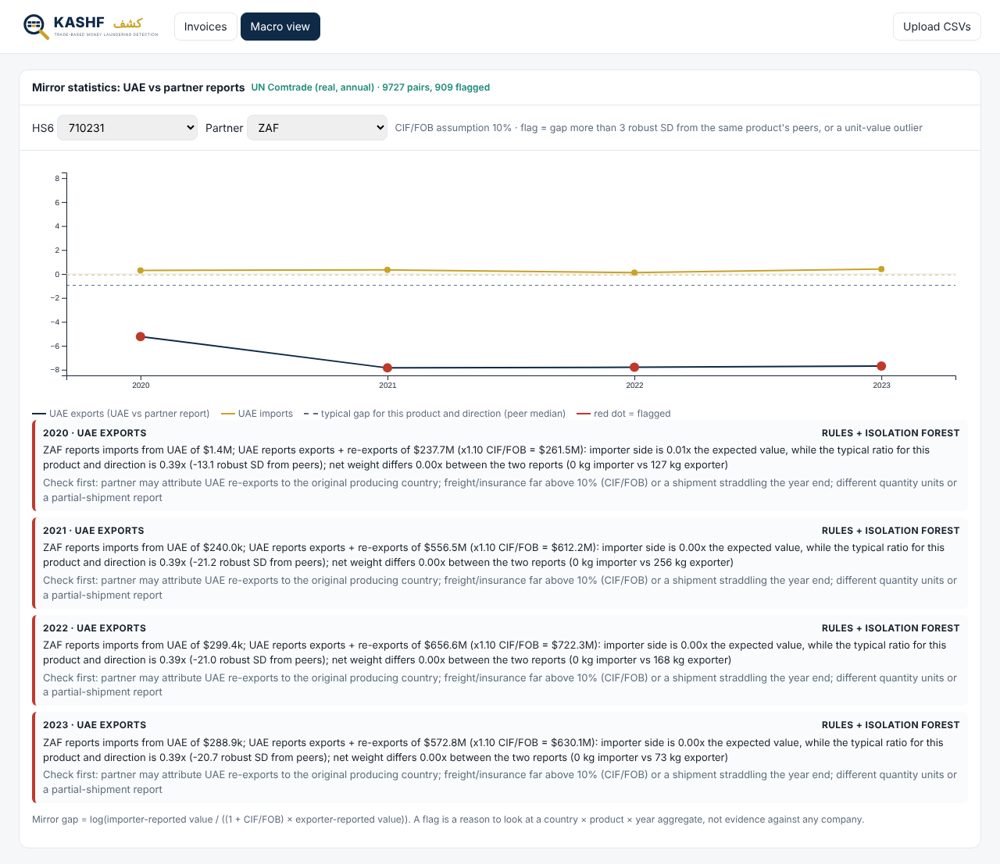
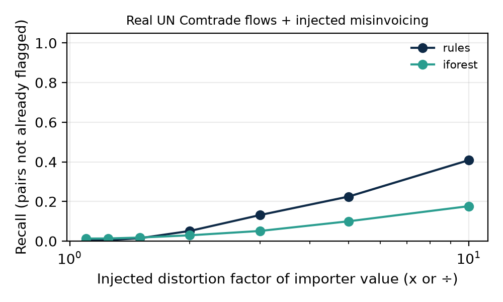

<p align="center"></p>

# Kashf (كشف)

[](https://github.com/lilanayele/kashf/actions/workflows/tests.yml)


**Explainable detection of trade-based money laundering (TBML) for UAE traders.**

**Live demo:** https://kashf.onrender.com *(placeholder until the Render service is created)*. Free hosting:
the service sleeps after 15 minutes without traffic, so the first load can take about 30 seconds.

Kashf checks a trading company's invoices, transport documents and counterparties for the red flags of trade-based money laundering: mispriced goods, shipments that never sailed, the same cargo invoiced twice, goods described as something else, money looping between companies, and "independent" buyers and sellers who share a director. Every alert shows the evidence behind it, so a compliance officer can confirm or dismiss it in minutes. The officer makes the final call; Kashf only drafts.


*Kashf (كشف) means "uncovering" in Arabic.*

📄 **Research paper:** [Kashf: Explainable Detection of Trade-Based Money Laundering in UAE Trade Records Using Calibrated Multi-Detector Evidence](paper/Kashf_Research_Paper.pdf) ([Word version](paper/Kashf_Research_Paper.docx))

## Why

Criminals use trade "to move money, rather than goods", and TBML is hard to spot because each transaction looks like normal business ([FATF and Egmont Group, 2020](https://www.fatf-gafi.org/en/publications/Methodsandtrends/Trade-based-money-laundering-trends-and-developments.html)). The UAE is one of the world's largest re-export hubs, and its 2024 National Risk Assessment lists the misuse of trade through front and shell companies and the misuse of free zones among its money-laundering concerns ([summary](https://www.crowe.com/ae/news/uae-national-risk-assessment-nra-2024)). Trade surveillance tools exist for banks; small traders and the consultancies serving them mostly review invoices by hand.

## How it works

```
 trade records ─┐                 ┌─ price benchmark      robust z vs reference unit values
 reference      ├─ intake ─────── ├─ route check          high-risk legs, loops, excess legs
 prices         │                 ├─ document consistency invoice ↔ B/L ↔ packing list, reused docs, unit weight
 risk lists ────┘                 └─ counterparty graph   shared director/phone/address/bank, circular trade
                                            │
                       calibrated scoring (noisy-OR) → alert + evidence → dashboard → draft case summary
```

| Detector | What it catches | Planted typologies |
|---|---|---|
| **Price benchmark** | Declared unit price far from the reference median, measured as a robust z-score of log price | Over-invoicing, under-invoicing, misdescription |
| **Document consistency** | Missing bill of lading or air waybill, impossible dates, unknown vessel, quantity/weight mismatches, one transport document cited by several invoices, implausible kg per unit for the HS code | Phantom shipments, multiple invoicing, misdescription |
| **Counterparty graph** | Buyer and seller linked by a shared director, phone, address or bank account (business-centre addresses ignored); the same goods travelling around a loop of companies | Shell clusters, circular trading |
| **Route check** | High-risk jurisdictions as party or transit, routes that pass a country twice, excess legs | (context signal) |

**Calibrated scoring.** Each rule's weight is its smoothed precision on a labelled tuning set (`(TP + 1) / (fired + 2)`), with price signals calibrated per band of the z-score. Signals combine by noisy-OR, `score = 1 − Π(1 − wᵢ)`. The weight shown next to each piece of evidence reads as "signals like this were laundering X% of the time".

<!-- EXPLAIN:START (generated by scripts/write_readme_results.py) -->
### What "explainable" means here, and how it is measured

**Definition.** An alert is explainable when it lists the specific evidence that produced it (the values, the benchmark and the rule) **and** removing that evidence removes the alert. Kashf's score is built from the evidence (noisy-OR), so this can be tested directly. Numbers from `results/explainability.md` (`python -m kashf.explain_eval`):

- **Evidence attribution (synthetic):** for every planted typology, at least 99.5% of true alerts cite a rule that matches the planted mechanism (lowest: name_variant). This is partly by construction (the detectors were written for these typologies), so it shows the evidence is *about the right thing*, not that the detectors generalise.
- **Deletion test (synthetic, 4,480 alerts on 5 held-out seeds):** dropping an alert's strongest signal removes the alert in 90.6% of cases, against 75.6% for dropping a random signal. For alerts with two or more signals: 78.2% vs 43.3%; the rest survive because a second, independent signal also crosses the threshold (redundant evidence). Removing all cited evidence removes every alert.
- **Macro layer (real UN Comtrade):** for the 378 pairs flagged by both the rules and the Isolation Forest, SHAP's top feature belongs to a rule that fired in 97.1% of cases (random: 36.3%).
- **Not yet measured:** whether the evidence makes analysts faster or more accurate. `docs/user_study.md` is a protocol with an empty results table; no study has been run.
<!-- EXPLAIN:END -->

<!-- SYNTH:START (generated by scripts/write_readme_results.py) -->
## Synthetic benchmark (invoice layer)

Evaluation on the synthetic UAE trade benchmark: about 5.7% of invoices are laundering across 10 typologies (including transshipment through FATF-listed jurisdictions, U-turn trade and name-variant shell networks). Thresholds and calibration were tuned on seed 0; results are the mean over 5 held-out seeds of 20,000 invoices each. Full tables: [`results/results.md`](results/results.md).

| Configuration | Precision | Recall | F1 | False-alarm rate | Avg. precision |
|---|---|---|---|---|---|
| **Kashf (calibrated)** | 0.863 | 0.682 | 0.762 | 0.66% | 0.817 |
| Kashf (hand-set weights) | 0.667 | 0.661 | 0.664 | 2.00% | 0.694 |
| Kashf, exact identifier matching only | 0.851 | 0.616 | 0.714 | 0.66% | 0.754 |
| Kashf without route detector | 0.897 | 0.611 | 0.727 | 0.42% | 0.697 |
| Price benchmark only | 0.604 | 0.231 | 0.334 | 0.92% | 0.264 |
| IQR price filter (de Boyrie, Pak & Zdanowicz) | 0.074 | 0.685 | 0.134 | 51.70% | 0.307 |
| Isolation forest | 0.170 | 0.312 | 0.220 | 9.23% | 0.145 |
| Manual-review checklist | 0.100 | 0.530 | 0.169 | 28.83% | 0.080 |

<p> </p>

What the numbers say:
- **Combining detectors matters most.** Without the document or graph detector F1 falls to 0.632 and 0.566.
- **The route detector now earns its place.** With route typologies in the benchmark it adds 0.035 F1 (recall on transshipment 0.00 → 0.51, U-turn 0.03 → 0.17), above the 0.01 bar for keeping it in the score. U-turn recall stays low because genuine returns of goods look the same.
- **Fuzzy entity resolution matters for disguised shells.** Recall on name-variant shell networks is 0.03 with exact identifier matching and 0.87 with normalised phones/addresses and rapidfuzz name matching.
- **Moderate mispricing is the hard case.** Recall is 0% for prices pushed 1.5–2× from the benchmark, 34% at 3–4× and 97% beyond 10×. The published IQR price filter flags 52% of clean invoices by construction.

> Synthetic data generated by the same author who wrote the detectors: these results show the method works, not how it would perform on real trade.

### Robustness checks (synthetic)

From [`results/robustness.md`](results/robustness.md), tuned on seed 0 and tested on seeds 1–3:

| Check | F1 | False-alarm rate |
|---|---|---|
| Default thresholds, same generator (seeds 1–3; the main table uses seeds 1–5) | 0.764 | 0.66% |
| Hand-set thresholds swept one at a time | 0.748–0.768 | |
| Alert threshold 0.2 → 0.8 (calibration fixed) | 0.668–0.767 | |
| **Generator shift** (more noise, subtler mispricing) | **0.647** | **2.02%** |
| **Different typology mechanics** (longer, slower rings; bank-linked shells; split multiple invoicing; subtler mispricing) | **0.720** | **0.68%** |

Under different typology mechanics, over- and under-invoicing recall falls to 0.12 and 0.06 and circular trading to 0.78: calibration must be refitted per data source. With **real UN Comtrade reference prices** the same benchmark gives F1 0.717 ([`results/real_reference/results.md`](results/real_reference/results.md)).
<!-- SYNTH:END -->

## Real data: macro layer on UN Comtrade mirror statistics

The invoice benchmark above is synthetic. The macro layer runs on **real** trade statistics: for each
UAE × partner × HS6 × year, it compares what the UAE reported with what the partner reported for the
same flow (mirror statistics), and checks each side's unit value against the global distribution for
that product.

| Feature | Definition |
|---|---|
| Mirror gap | log(importer-reported value / (1.10 × exporter-reported value)); 10% CIF/FOB margin is a documented assumption |
| Weight gap | log(importer net weight / exporter net weight) |
| Unit-value z | robust z of each side's unit value vs all reporters' exports of that HS6 in that year (price-filter idea, Zdanowicz 2009) |

Two detectors are compared: rules (each pair against the median of the same product and direction;
fixed absolute thresholds are also reported, and fail on real data) and an Isolation Forest, with SHAP
explanations per flag. Detection is measured
by injecting known over/under-invoicing (±10%, 25%, 50%, 100%) into the real flows, and the top 10
flagged real flows are written up with the benign explanations to check first
(re-exports, CIF/FOB, free zones, timing, classification).

```bash
cp .env.example .env              # then put your UN Comtrade key in .env (never commit it)
bash scripts/run_real.sh          # ~17 API calls; results in results/macro/macro_results.md
```

<!-- REAL_RESULTS_START -->
### Real-data results (UN Comtrade)

*Label: real (UN Comtrade) flows; detection rates use injected distortions on those real flows.*



Label: **real (UN Comtrade)**. Annual HS data at total level (partner2 = World, all customs procedures, all transport modes), cached in data/raw/ by kashf.comtrade (pulled through the API, or saved API responses imported with `python -m kashf.comtrade import`). Comtrade-estimated quantities and weights and quantities in non-standard units are excluded. Coverage and caveats: docs/DATA_CARD.md.

- Mirror pairs: 19,007 (eligible, both sides >= $100.0k: 9,727)
- Years: 2020, 2021, 2022, 2023; partners: 156; HS6 codes: 43
- Median |log mirror gap|: 1.18 (sides typically differ by 3.25x after the CIF/FOB adjustment)
- Median mirror gap by direction: uae_export -1.41 (importer reports 0.24x the CIF-adjusted exporter value), uae_import +0.01 (importer reports 1.01x the CIF-adjusted exporter value)
- UAE exports, re-exports reported explicitly: re-exports (RX) are 34% of the UAE-reported export value in these pairs. Median gap against X + RX -1.41 (partner reports 0.24x); against domestic exports X only -0.89 (0.41x; 5,581 pairs with X > 0)
- Flag rate on real data: rules (relative baseline) 9.3%, Isolation Forest 5.0%; agreement 93.4%

**Fixed thresholds failed on real data.** The absolute thresholds set before seeing real data (|gap| > ln 1.5) flag 84% of real pairs, because UAE-export gaps are systematically negative: partners record most UAE re-exports under the country of origin. After seeing this, the rules compare each pair with the median of the same HS6 and direction (robust z). This change was made after looking at the real data and is disclosed here.

#### Detection of injected misinvoicing (semi-synthetic: real flows + known distortion)

5% of eligible pairs have the importer-reported value pushed up or down by the stated size; mean over 5 repeats. Thresholds from configs/default.yaml, not tuned on the injected data. Precision is a lower bound: naturally anomalous real flows count as false positives. 'Recall on unflagged' counts only injected pairs the rules did not already flag before injection.

| Method | Distortion | Recall | Recall on unflagged | Precision (lower bound) | Flag rate | PR-AUC | PR-AUC (random) |
|---|---|---|---|---|---|---|---|
| iforest | +/-10% | 0.05 | 0.01 | 0.05 | 5.0% | 0.05 | 0.05 |
| rules | +/-10% | 0.10 | 0.00 | 0.05 | 9.3% | 0.05 | 0.05 |
| iforest | +/-25% | 0.06 | 0.01 | 0.06 | 5.0% | 0.05 | 0.05 |
| rules | +/-25% | 0.10 | 0.01 | 0.05 | 9.3% | 0.05 | 0.05 |
| iforest | +/-50% | 0.06 | 0.02 | 0.06 | 5.0% | 0.06 | 0.05 |
| rules | +/-50% | 0.10 | 0.01 | 0.06 | 9.3% | 0.06 | 0.05 |
| iforest | +/-100% | 0.07 | 0.03 | 0.07 | 5.0% | 0.06 | 0.05 |
| rules | +/-100% | 0.13 | 0.05 | 0.07 | 9.4% | 0.06 | 0.05 |
| iforest | x/÷3 | 0.10 | 0.05 | 0.09 | 5.0% | 0.08 | 0.05 |
| rules | x/÷3 | 0.20 | 0.13 | 0.11 | 9.6% | 0.08 | 0.05 |
| iforest | x/÷5 | 0.14 | 0.10 | 0.14 | 5.0% | 0.10 | 0.05 |
| rules | x/÷5 | 0.29 | 0.22 | 0.14 | 9.9% | 0.12 | 0.05 |
| iforest | x/÷10 | 0.21 | 0.18 | 0.21 | 5.0% | 0.15 | 0.05 |
| rules | x/÷10 | 0.45 | 0.41 | 0.21 | 10.6% | 0.20 | 0.05 |

#### Case study: top 10 flagged UAE flows on the real data

Flags are reasons to look, not findings. Each row lists the benign explanations to rule out first.

**1. ITA -> UAE, HS 710813 Gold, semi-manufactured, 2023** (rule score 7.6; Isolation Forest not flagged)
- Why flagged: exporter's unit value $1.1k/kg is -22.8 robust SD from the global median $55.8k/kg for HS 710813 in 2023
- Isolation Forest: SHAP: uv_z_exp (+3.91), gap_rz (+0.20)
- Check first: UAE may record origin while the partner recorded a different destination (transshipment through a third country); freight/insurance far above 10% (CIF/FOB) or a shipment straddling the year end; different quantity units or a partial-shipment report; product mix inside one HS6 code (premium vs basic models) or a classification difference

**2. UAE -> ZAF, HS 710231 Diamonds; non-industrial, unworked or si, 2021** (rule score 7.1; Isolation Forest flagged)
- Why flagged: ZAF reports imports from UAE of $240.0k; UAE reports exports + re-exports of $556.5M (x1.10 CIF/FOB = $612.2M): importer side is 0.00x the expected value, while the typical ratio for this product and direction is 0.39x (-21.2 robust SD from peers); net weight differs 0.00x between the two reports (0 kg importer vs 256 kg exporter)
- Isolation Forest: SHAP: gap_rz (+3.18), wgap_rz (+2.75)
- Check first: partner may attribute UAE re-exports to the original producing country; freight/insurance far above 10% (CIF/FOB) or a shipment straddling the year end; different quantity units or a partial-shipment report

**3. UAE -> ZAF, HS 710231 Diamonds; non-industrial, unworked or si, 2022** (rule score 7.0; Isolation Forest flagged)
- Why flagged: ZAF reports imports from UAE of $299.4k; UAE reports exports + re-exports of $656.6M (x1.10 CIF/FOB = $722.3M): importer side is 0.00x the expected value, while the typical ratio for this product and direction is 0.39x (-21.0 robust SD from peers); net weight differs 0.00x between the two reports (0 kg importer vs 168 kg exporter)
- Isolation Forest: SHAP: gap_rz (+3.23), wgap_rz (+2.77)
- Check first: partner may attribute UAE re-exports to the original producing country; freight/insurance far above 10% (CIF/FOB) or a shipment straddling the year end; different quantity units or a partial-shipment report

**4. UAE -> ZAF, HS 710231 Diamonds; non-industrial, unworked or si, 2023** (rule score 6.9; Isolation Forest flagged)
- Why flagged: ZAF reports imports from UAE of $288.9k; UAE reports exports + re-exports of $572.8M (x1.10 CIF/FOB = $630.1M): importer side is 0.00x the expected value, while the typical ratio for this product and direction is 0.39x (-20.7 robust SD from peers); net weight differs 0.00x between the two reports (0 kg importer vs 73 kg exporter)
- Isolation Forest: SHAP: gap_rz (+3.36), wgap_rz (+2.81)
- Check first: partner may attribute UAE re-exports to the original producing country; freight/insurance far above 10% (CIF/FOB) or a shipment straddling the year end; different quantity units or a partial-shipment report

**5. UAE -> OMN, HS 710813 Gold, semi-manufactured, 2023** (rule score 6.6; Isolation Forest flagged)
- Why flagged: exporter's unit value $1.9k/kg is -19.8 robust SD from the global median $55.8k/kg for HS 710813 in 2023
- Isolation Forest: SHAP: uv_z_exp (+3.67), uv_z_imp (+0.86)
- Check first: goods shipped via UAE free zones may leave outside UAE customs statistics while the partner records the UAE as consignor; freight/insurance far above 10% (CIF/FOB) or a shipment straddling the year end; different quantity units or a partial-shipment report; product mix inside one HS6 code (premium vs basic models) or a classification difference

**6. UAE -> THA, HS 710231 Diamonds; non-industrial, unworked or si, 2021** (rule score 6.4; Isolation Forest not flagged)
- Why flagged: net weight differs 2141.36x between the two reports (47,110 kg importer vs 22 kg exporter)
- Isolation Forest: SHAP: wgap_rz (+3.43), uv_z_imp (+0.08)
- Check first: partner may attribute UAE re-exports to the original producing country; freight/insurance far above 10% (CIF/FOB) or a shipment straddling the year end; different quantity units or a partial-shipment report

**7. FRA -> UAE, HS 710813 Gold, semi-manufactured, 2022** (rule score 6.4; Isolation Forest flagged)
- Why flagged: importer's unit value $155/kg is -19.2 robust SD from the global median $47.0k/kg for HS 710813 in 2022
- Isolation Forest: SHAP: uv_z_imp (+3.00), uv_z_exp_missing (+1.01)
- Check first: UAE may record origin while the partner recorded a different destination (transshipment through a third country); product mix inside one HS6 code (premium vs basic models) or a classification difference

**8. IND -> UAE, HS 721420 Steel bars, 2022** (rule score 6.2; Isolation Forest flagged)
- Why flagged: UAE reports imports from IND of $652.3k; IND reports exports to UAE of $271.6k (x1.10 CIF/FOB = $298.8k): importer side is 2.18x the expected value, while the typical ratio for this product and direction is 0.95x (+3.9 robust SD from peers); net weight differs 3.94x between the two reports (1,078,460 kg importer vs 273,564 kg exporter)
- Isolation Forest: SHAP: wgap_rz (+2.88), gap_rz (+2.06)
- Check first: UAE may record origin while the partner recorded a different destination (transshipment through a third country); freight/insurance far above 10% (CIF/FOB) or a shipment straddling the year end; different quantity units or a partial-shipment report

**9. UAE -> THA, HS 710231 Diamonds; non-industrial, unworked or si, 2020** (rule score 5.9; Isolation Forest not flagged)
- Why flagged: net weight differs 1083.42x between the two reports (25,677 kg importer vs 24 kg exporter)
- Isolation Forest: SHAP: wgap_rz (+3.48), uv_z_imp (-0.08)
- Check first: partner may attribute UAE re-exports to the original producing country; freight/insurance far above 10% (CIF/FOB) or a shipment straddling the year end; different quantity units or a partial-shipment report

**10. BEN -> UAE, HS 710812 Metals; gold, non-monetary, unwrought (b, 2020** (rule score 5.9; Isolation Forest flagged)
- Why flagged: UAE reports imports from BEN of $542.6M; BEN reports exports to UAE of $176.4k (x1.10 CIF/FOB = $194.0k): importer side is 2797.11x the expected value, while the typical ratio for this product and direction is 2.13x (+5.8 robust SD from peers); exporter's unit value $1.7k/kg is -17.6 robust SD from the global median $49.3k/kg for HS 710812 in 2020
- Isolation Forest: SHAP: uv_z_exp (+3.04), gap_rz (+2.53)
- Check first: UAE may record origin while the partner recorded a different destination (transshipment through a third country); freight/insurance far above 10% (CIF/FOB) or a shipment straddling the year end; different quantity units or a partial-shipment report; product mix inside one HS6 code (premium vs basic models) or a classification difference


<!-- REAL_RESULTS_END -->

Data source, coverage and caveats: [`docs/DATA_CARD.md`](docs/DATA_CARD.md) (generated from the pull).
A macro flag is a reason to look at a country × product aggregate, not evidence against any company.

<!-- CHECKS:START (generated by scripts/write_readme_results.py) -->
## External and independent checks

Summary of all reviewer fixes, with every number's source: [`results/reviewer_fixes.md`](results/reviewer_fixes.md).

- **Published gold flows (real data, not laundering labels).** SWISSAID reports name 24 UAE gold flows as mismatched or as smuggling transit routes (`data/external_validation.csv`, with sources and pages). 10 exist as mirror pairs. Kashf's rules flag 4/4 documented mismatches and 0/6 transit flows, but rank them mid-table (median rank 4962 of 9,727); a GFI-style dollar gap ranks them far higher (median 361). [`results/external_validation.md`](results/external_validation.md)
- **IBM AMLworld (independent synthetic data).** Only the circular-trade rule applies. As shipped it finds 1% of cycle-pattern transfers; adapted to transfer data (timestamps, USD amounts, up to 10 hops; not tuned on labels) it finds 52% at precision 0.95, against 30% at precision 0.14 for a time-free cycle check. Overall recall is 3.9% because most AMLworld laundering is not cyclic. [`results/amlworld.md`](results/amlworld.md). To reproduce, download `HI-Small_Trans.csv` and `HI-Small_Patterns.txt` from the [Kaggle dataset](https://www.kaggle.com/datasets/ealtman2019/ibm-transactions-for-anti-money-laundering-aml) (not redistributed here) and run `python -m kashf.amlworld --trans HI-Small_Trans.csv --patterns HI-Small_Patterns.txt`.
- **Public FATF/Egmont cases (reconstructed).** Evidence surfaces in 4/4 schemes visible in trade records; only 1/4 crosses the alert threshold. Payment-side schemes are blind spots. [`results/public_cases.md`](results/public_cases.md)
- **Published baselines.** On injected real distortions an IQR price filter matches or beats Kashf's rules at the same flag rate for ×2–×5 distortions; Kashf is ahead at ×10. [`results/macro/injection_summary.csv`](results/macro/injection_summary.csv)
<!-- CHECKS:END -->

## Quick start

```bash
git clone https://github.com/lilanayele/kashf && cd kashf
python3 -m venv .venv && source .venv/bin/activate
pip install --upgrade pip          # needed on macOS's built-in Python (old pip)
pip install -r requirements.txt && pip install --no-deps -e .   # pinned, tested on Python 3.9 and 3.12

kashf generate --seed 7 --out data/demo        # synthetic UAE trade dataset
kashf analyse data/demo --out output           # alerts.csv, signals.csv, entities.csv
kashf case data/demo INV-2025-000725           # draft case summary (Markdown)
kashf serve data/demo                          # dashboard: http://127.0.0.1:8800
kashf evaluate --seeds 5                       # reproduce the results (~1 min)
pytest -q                                      # unit tests, no network needed
```

Docker: `docker build -t kashf . && docker run -p 8800:8800 kashf` (no Comtrade key needed at runtime).

## Deploy free on Render

`render.yaml` defines one free Docker web service with a `/health` check, auto-deployed from `main`.
On render.com: **New → Blueprint → connect `lilanayele/kashf` → Apply**. The image builds synthetic
demo invoices at build time, uses `data/reference_comtrade.csv` and `results/macro/` when they are
committed, and stays under the free tier's 512 MB (about 160–240 MB measured). Uploads are limited to
10 MB of CSV files.

## Use your own data

Put four CSV files in a folder (or upload them in the dashboard):

| File | Columns |
|---|---|
| `entities.csv` | entity_id, name, kind, country, address, phone, director_id, bank_account |
| `invoices.csv` | invoice_no, date, seller_id, buyer_id, hs6, description, quantity, unit, unit_price_usd, value_usd, declared_weight_kg, origin, destination, route (e.g. `AE>OM>IN`), doc_no |
| `transport_docs.csv` | doc_no, doc_type, carrier_or_vessel, departure_date, quantity, gross_weight_kg, port_load, port_discharge |
| `packing_lists.csv` | invoice_no, quantity, net_weight_kg |

Real reference prices from UN Comtrade (free account; 500 API calls/day). The key goes in `.env`
(gitignored), never in code:

```bash
python -m kashf.comtrade test                       # one call to check the key
python -m kashf.comtrade pull                       # cached in data/raw/, every call logged
python -m kashf.comtrade reference                  # data/reference_comtrade.csv; fails loudly, never falls back
kashf analyse my_data/ --reference data/reference_comtrade.csv
```

All thresholds live in `configs/default.yaml`. Recalibrate on cases your analysts have already closed
before relying on the weights.

## Project layout

```
kashf/
  generate.py     synthetic UAE trade world + 7 planted TBML typologies (ground truth kept separate)
  reference.py    reference unit-price table (illustrative default; real one from comtrade.py)
  comtrade.py     UN Comtrade client: cached, logged, retried pulls; real reference table; data card
  macro.py        mirror-gap + unit-value detectors on real Comtrade data, injection evaluation, case study
  config.py       Settings, loaded from configs/default.yaml
  detectors.py    price, route, documents, counterparty graph — every signal carries its evidence
  calibrate.py    per-rule calibration on labelled cases
  scoring.py      noisy-OR invoice score, company risk
  report.py       draft case summaries (Markdown / HTML)
  evaluate.py     tuning/test protocol, baselines, ablations, figures, sensitivity + generator-shift checks
  api.py          FastAPI backend;  static/  dashboard, logo, d3
configs/default.yaml   every threshold in one place
scripts/run_real.sh    pull real data and produce all real-data results
paper/            research paper (PDF + Word) and the script that builds it from results/
results/          summary.json, results.md, calibration.json, figures/
docs/             dashboard screenshot, brand assets (logo, icon), figures
tests/
```

## Limitations and ethics

- Synthetic data cannot capture every pattern of real trade. The invoice-layer results should be re-measured on real, analyst-labelled cases.
- The macro layer uses real data but has no ground-truth laundering labels; its detection rates are measured on injected distortions, and its precision counts every natural anomaly as a false positive.
- Mirror gaps have many benign causes (re-exports, free zones, CIF/FOB, timing, classification); see `docs/DATA_CARD.md`.
- Reference prices are averages over broad HS codes, so legitimate premium goods can look over-priced. The evidence view shows the benchmark so an analyst can judge.
- High-risk jurisdictions come from the FATF lists of 30 October 2026 (`configs/fatf_lists.yaml`); they change three times a year, so run `scripts/update_fatf_lists.py` and re-check before use.
- Explanations have not been tested with analysts (see `docs/user_study.md`).
- On tests Kashf did not design, simple published methods sometimes do better: an IQR price filter on injected unit-value distortions, a GFI-style dollar gap on ranking published gold flows; and the cycle rule as shipped misses AMLworld's multi-currency cycles until adapted (see External and independent checks).
- Mirror screening only sees flows that both sides report: partners that do not report to UN Comtrade (several gold-transit countries named in published reports) are invisible to the macro layer.
- Kashf supports human decisions. It does not file reports or label anyone a criminal. No real customer data was used to build it.

## Author

Lilan Getachew · B.Tech Computer Science and Engineering, Amity University Dubai · [github.com/lilanayele](https://github.com/lilanayele)

MIT licence.
