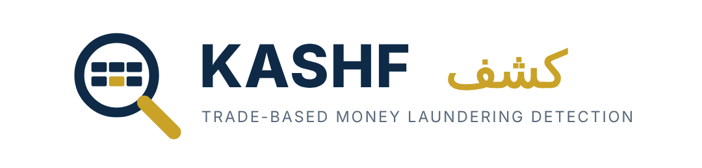
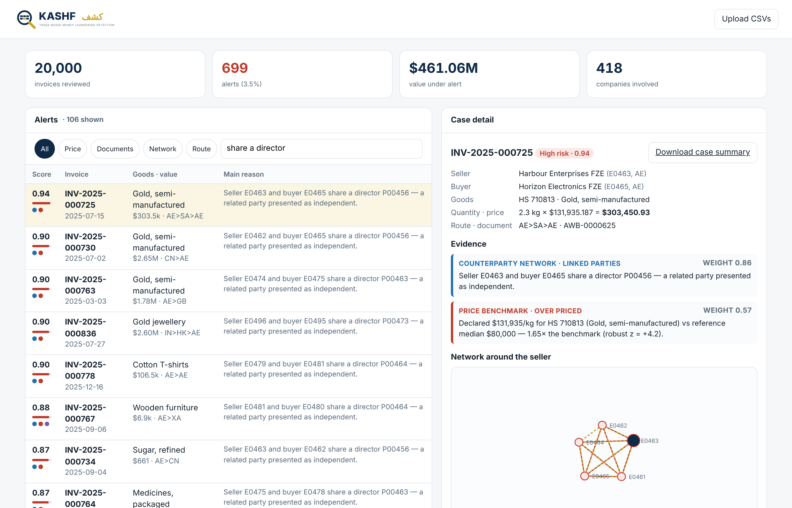
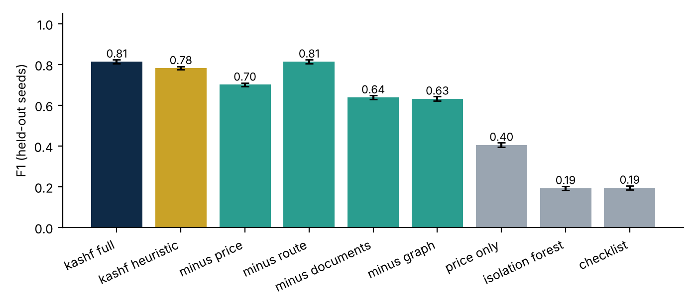
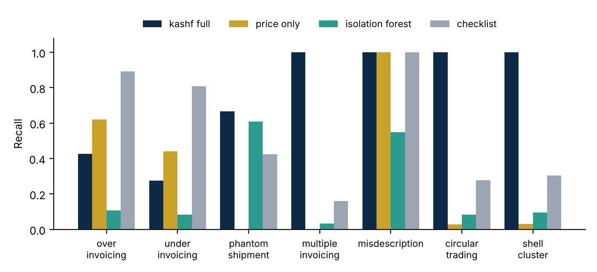

<p align="center"></p>

# Kashf (كشف)

[](https://github.com/lilanayele/kashf/actions/workflows/tests.yml)


**Explainable detection of trade-based money laundering (TBML) for UAE traders.**

Kashf checks a trading company's invoices, transport documents and counterparties for the red flags of trade-based money laundering: mispriced goods, shipments that never sailed, the same cargo invoiced twice, goods described as something else, money looping between companies, and "independent" buyers and sellers who share a director. Every alert shows the evidence behind it, so a compliance officer can confirm or dismiss it in minutes. The officer makes the final call; Kashf only drafts.



*Kashf (كشف) means "uncovering" in Arabic.*

📄 **Research paper:** [Kashf: Explainable Detection of Trade-Based Money Laundering in UAE Trade Records Using Calibrated Multi-Detector Evidence](paper/Kashf_Research_Paper.pdf) ([Word version](paper/Kashf_Research_Paper.docx))

## Why

Criminals use trade "to move money, rather than goods", and TBML is hard to spot because each transaction looks like normal business ([FATF and Egmont Group, 2020](https://www.fatf-gafi.org/en/publications/Methodsandtrends/Trade-based-money-laundering-trends-and-developments.html)). The UAE is one of the world's largest re-export hubs, and its 2024 National Risk Assessment lists the misuse of trade through front and shell companies and the misuse of free zones among its money-laundering concerns ([summary](https://www.crowe.com/ae/news/uae-national-risk-assessment-nra-2024)). Trade surveillance tools exist for banks; small traders and the consultancies serving them mostly review invoices by hand.

## How it works

```
 trade records ─┐                 ┌─ price benchmark      robust z vs reference unit values
 reference      ├─ intake ─────── ├─ route check          high-risk legs, loops, excess legs
 prices         │                 ├─ document consistency invoice ↔ B/L ↔ packing list, reused docs, unit weight
 risk lists ────┘                 └─ counterparty graph   shared director/phone/address/bank, circular trade
                                            │
                       calibrated scoring (noisy-OR) → alert + evidence → dashboard → draft case summary
```

| Detector | What it catches | Planted typologies |
|---|---|---|
| **Price benchmark** | Declared unit price far from the reference median, measured as a robust z-score of log price | Over-invoicing, under-invoicing, misdescription |
| **Document consistency** | Missing bill of lading or air waybill, impossible dates, unknown vessel, quantity/weight mismatches, one transport document cited by several invoices, implausible kg per unit for the HS code | Phantom shipments, multiple invoicing, misdescription |
| **Counterparty graph** | Buyer and seller linked by a shared director, phone, address or bank account (business-centre addresses ignored); the same goods travelling around a loop of companies | Shell clusters, circular trading |
| **Route check** | High-risk jurisdictions as party or transit, routes that pass a country twice, excess legs | (context signal) |

**Calibrated scoring.** Each rule's weight is its smoothed precision on a labelled tuning set (`(TP + 1) / (fired + 2)`), with price signals calibrated per band of the z-score. Signals combine by noisy-OR, `score = 1 − Π(1 − wᵢ)`. The weight shown next to each piece of evidence reads as "signals like this were laundering X% of the time".

## Results (synthetic benchmark)

Evaluation on the synthetic UAE trade benchmark: about 4% of invoices are laundering across 7 typologies. Thresholds and calibration were tuned on seed 0, and results are the mean over 5 held-out seeds of 20,000 invoices each. Full tables are in [`results/results.md`](results/results.md).

| Configuration | Precision | Recall | F1 | False-alarm rate | Avg. precision |
|---|---|---|---|---|---|
| **Kashf (calibrated)** | **0.876** | 0.759 | **0.814** | **0.45%** | **0.845** |
| Kashf (hand-set weights) | 0.774 | 0.789 | 0.781 | 0.98% | 0.797 |
| Price benchmark only | 0.574 | 0.313 | 0.405 | 0.98% | 0.311 |
| Isolation forest | 0.167 | 0.227 | 0.192 | 4.80% | 0.116 |
| Manual-review checklist | 0.117 | 0.562 | 0.194 | 17.89% | 0.084 |

<p> </p>

What the numbers say:
- **Combining detectors matters most.** Removing the document or graph detector cuts F1 to 0.64 and 0.63.
- **Calibration helps.** It raises precision from 0.77 to 0.88 and halves false alarms.
- **Moderate mispricing is the hard case.** Kashf catches 0% of prices pushed less than 2× from the benchmark, 31% at 3–4×, and 97% beyond 10×, because legitimate premium and clearance goods overlap with mild manipulation. The checklist catches more over-invoicing (0.89 recall) but raises an alert on 18% of clean invoices.
- **The route detector adds nothing on this benchmark.** F1 is unchanged without it. It is kept as context for analysts, and the benchmark needs route-based typologies to test it.

> These results come from synthetic data generated by the same author who wrote the detectors, so they show the method works, not how it would perform on real trade. The reference price table is illustrative; run `scripts/fetch_comtrade.py` to use UN Comtrade data.

## Quick start

```bash
git clone https://github.com/lilanayele/kashf && cd kashf
python3 -m venv .venv && source .venv/bin/activate
pip install --upgrade pip          # needed on macOS's built-in Python (old pip)
pip install -e ".[dev]"

kashf generate --seed 7 --out data/demo        # synthetic UAE trade dataset
kashf analyse data/demo --out output           # alerts.csv, signals.csv, entities.csv
kashf case data/demo INV-2025-000725           # draft case summary (Markdown)
kashf serve data/demo                          # dashboard: http://127.0.0.1:8800
kashf evaluate --seeds 5                       # reproduce the results (~1 min)
pytest -q                                      # 14 tests
```

Docker: `docker build -t kashf . && docker run -p 8800:8800 kashf`

## Use your own data

Put four CSV files in a folder (or upload them in the dashboard):

| File | Columns |
|---|---|
| `entities.csv` | entity_id, name, kind, country, address, phone, director_id, bank_account |
| `invoices.csv` | invoice_no, date, seller_id, buyer_id, hs6, description, quantity, unit, unit_price_usd, value_usd, declared_weight_kg, origin, destination, route (e.g. `AE>OM>IN`), doc_no |
| `transport_docs.csv` | doc_no, doc_type, carrier_or_vessel, departure_date, quantity, gross_weight_kg, port_load, port_discharge |
| `packing_lists.csv` | invoice_no, quantity, net_weight_kg |

Real reference prices from UN Comtrade (free account; 500 API calls/day):

```bash
export COMTRADE_KEY=...    # your subscription key
python scripts/fetch_comtrade.py --year 2024 --out data/reference_comtrade.csv
kashf analyse my_data/ --reference data/reference_comtrade.csv
```

The Comtrade script could not be tested from the build environment, which had no access to the Comtrade API; check field names against the current API docs if a call fails. Recalibrate on cases your analysts have already closed before relying on the weights.

## Project layout

```
kashf/
  generate.py     synthetic UAE trade world + 7 planted TBML typologies (ground truth kept separate)
  reference.py    reference unit-price table (illustrative default; Comtrade loader)
  detectors.py    price, route, documents, counterparty graph — every signal carries its evidence
  calibrate.py    per-rule calibration on labelled cases
  scoring.py      noisy-OR invoice score, company risk
  report.py       draft case summaries (Markdown / HTML)
  evaluate.py     tuning/test protocol, baselines, ablations, figures
  api.py          FastAPI backend;  static/  dashboard, logo, d3
scripts/fetch_comtrade.py
paper/            research paper (PDF + Word) and the script that builds it from results/
results/          summary.json, results.md, calibration.json, figures/
docs/             dashboard screenshot, brand assets (logo, icon), figures
tests/
```

## Limitations and ethics

- Synthetic data cannot capture every pattern of real trade. Results should be re-measured on real, analyst-labelled cases.
- Reference prices are averages over broad HS codes, so legitimate premium goods can look over-priced. The evidence view shows the benchmark so an analyst can judge.
- The high-risk jurisdiction list is illustrative (XA, XB, XC). Load the current FATF lists in production.
- Kashf supports human decisions. It does not file reports or label anyone a criminal. No real customer data was used to build it.

## Author

Lilan Getachew · B.Tech Computer Science and Engineering, Amity University Dubai · [github.com/lilanayele](https://github.com/lilanayele)

MIT licence.
